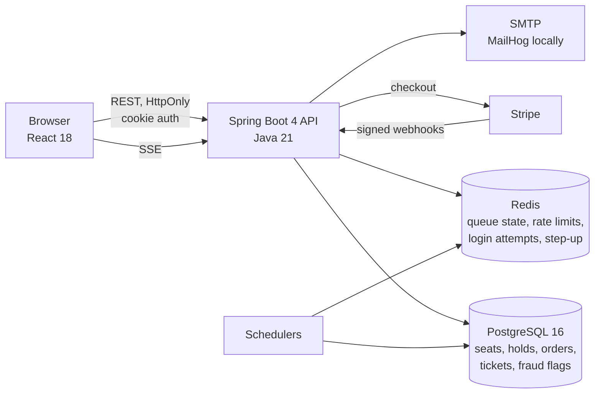

# FairTix

Concert tickets without the fluff. A ticketing platform designed around the
failure modes of an on-sale: a waiting room that admits fans in batches, seat
holds that cannot be double-sold, per-account risk scoring with step-up checks,
and Stripe payments with verified webhooks.

[](https://github.com/firegiant9000/FairTix/actions/workflows/ci.yml)

> **Status:** University team project (Spring 2026) that I continued through
> milestones M1 to M8 after the course. It runs end to end locally with Docker
> Compose. Apart from a course-demo deployment on free Railway and Netlify tiers
> in April 2026, now unmaintained, it has never been deployed and has no live
> users.
> Stripe and reCAPTCHA are integrated but disabled by default.
>
> **Direction (2026-09):** FairTix is a technical showcase, not a business. It
> is being used as a distributed-systems and production-backend laboratory
> (real-Postgres contention tests, Terraform-defined AWS lab environment,
> multi-instance correctness, OpenTelemetry and SLOs, k6 load and failure
> drills). See the 2026-09 revision at the top of
> [STRATEGIC_ROADMAP.md](STRATEGIC_ROADMAP.md) and the audit in
> [docs/roadmap-review-2026-09.md](docs/roadmap-review-2026-09.md).
> Only two figures below are measurements: the seat-hold contention test
> ([docs/experiments/l1-contention-correctness.md](docs/experiments/l1-contention-correctness.md))
> and one queue-join run on a laptop (the
> [rollout runbook](docs/runbooks/cap-queue-rollout.md)). Neither is a
> production performance figure.

<!-- Screenshots: docs/screenshots/ does not exist yet. Capture the event page,
     the waiting room, the seat map with a live hold, and the organizer
     settlement view, then link them here. -->

## Engineering highlights

- **Seat holds use PostgreSQL row locks, not Redis.**
  [`SeatRepository`](backend/src/main/java/com/fairtix/inventory/infrastructure/SeatRepository.java)
  locks the requested seats with `LockModeType.PESSIMISTIC_WRITE`, and
  [`SeatHoldService`](backend/src/main/java/com/fairtix/inventory/application/SeatHoldService.java)
  sorts seat IDs before locking so two concurrent holds on overlapping seats
  cannot deadlock. Holds carry an expiry, and
  [`HoldExpirationScheduler`](backend/src/main/java/com/fairtix/inventory/scheduler/HoldExpirationScheduler.java)
  sweeps expired holds back to available every 30 seconds.
- **Waiting room over Server-Sent Events.**
  [`QueueService`](backend/src/main/java/com/fairtix/queue/application/QueueService.java)
  keeps queue entries and admission in PostgreSQL, with position counters and a
  copy of the admitted set in Redis (Redisson). It admits fans in configurable
  batches, and
  [`QueueSseService`](backend/src/main/java/com/fairtix/queue/application/QueueSseService.java)
  pushes position updates to each connected browser. On an event that requires
  the queue, creating a hold and checking out both check admission on the
  server, so the client cannot skip it.
- **Account risk scoring with step-up checks.** The
  [`fraud`](backend/src/main/java/com/fairtix/fraud) package scores each account
  (not each order) from suspicious-activity flags, payment failures and account
  age (`RiskScoringService`), and runs a scheduled behaviour sweep. The
  resulting tier is used in four places: a step-up challenge before checkout
  and hold creation (`StepUpGateService`, `StepUpFilter`), a refusal to join a
  queue or start a transfer at the highest tier, and manual review for refund
  requests from high-risk accounts. Admins can review flags through
  `FraudAdminController`.
- **Purchase caps and the waiting room are serialised in PostgreSQL.**
  [`TransactionLock`](backend/src/main/java/com/fairtix/common/TransactionLock.java)
  wraps a transaction-level advisory lock (`pg_advisory_xact_lock`) with a
  bounded wait (`fairtix.transaction-lock.wait-ms`, 3 s by default; a timeout is
  a retryable 409). The per-(event, user) cap lock in
  [`PurchaseCapGuard`](backend/src/main/java/com/fairtix/tickets/application/PurchaseCapGuard.java)
  covers holds, checkout, comps and transfer accepts, and counts held, bought
  and comped tickets. A per-user lock serialises the active-holds limit
  (`holds.max-active-per-holder`, 5 by default), a per-event lock the comp
  limit. Locks are taken in one order (hold limit or comp limit, then the cap,
  then the per-event sale lock, then row locks) so these paths cannot deadlock
  with each other; the one known exception is listed under
  [Known limitations](#known-limitations). Queue
  admission is read from the database; the Redis admitted set is a copy written
  after commit, so a Redis failure cannot grant or revoke checkout.
- **Stripe payments are idempotent and bound to what they pay for.** Every
  call that creates a PaymentIntent, a refund or a connected account carries a
  deterministic idempotency key
  ([`StripeIdempotencyKeys`](backend/src/main/java/com/fairtix/payments/application/StripeIdempotencyKeys.java)),
  and checkout and refunds call Stripe outside database transactions. One
  PaymentIntent is kept
  per user and hold set (`online_payment_intents`), carries its owner in its
  metadata, and at checkout must match the stored user, hold set and payout
  routing. A resubmit after a lost response gets the existing order back; a
  refunded or disputed intent is refused. A charge that succeeds without an
  order is audited (`STRIPE_ORDER_FAILED` / `STRIPE_ORDER_BUSY`) for the manual
  refund runbook in [docs/runbooks](docs/runbooks).
- **Stripe webhooks are signature-verified and deduplicated.**
  [`StripeWebhookController`](backend/src/main/java/com/fairtix/payments/api/StripeWebhookController.java)
  reconstructs every event with `Webhook.constructEvent`, rejects anything that
  fails verification, and records each handled event id in
  `stripe_webhook_events` in the same transaction as its handling, so a
  redelivered event is answered 200 without being processed again.
- **Mail goes out after commit.** Transfer, refund and order mail is sent once
  the transaction commits, so a mail failure cannot roll back the change and a
  rolled-back change sends no mail.
- **Rate limiting and abuse controls.** Per-route limits keyed by user or IP
  through Redisson rate limiters (`RateLimitService`), login-attempt tracking,
  reCAPTCHA on login after repeated failures (when enabled), and velocity
  limits on ticket transfers.
- **Security gates in CI.** Every pull request to `main` runs the backend
  tests, the frontend tests with coverage, OWASP Dependency-Check, and a Trivy
  scan of the backend image that fails on CRITICAL or HIGH findings not listed
  in [.trivyignore](.trivyignore).

## Architecture



The backend is organised by domain, one package per module under
`backend/src/main/java/com/fairtix/` (among them `events`, `inventory`,
`holds`, `queue`, `orders`, `payments`, `refunds`, `tickets`, `boxoffice`,
`organizations`, `fraud`, `auth`, `users` and `audit`), each split into `api`,
`application`, `domain` and `infrastructure` layers. Schema changes are
forward-only Flyway migrations under `backend/src/main/resources/db/migration`
(54 at V54; `ls backend/src/main/resources/db/migration | wc -l` for the
current count).

## Tech stack

| Layer | Choice |
| --- | --- |
| Backend | Java 21, Spring Boot 4.1, Spring Security, Spring Data JPA |
| Database | PostgreSQL 16, Flyway migrations |
| Cache and coordination | Redis 7 via Redisson |
| Payments | Stripe (checkout and signed webhooks), disabled by default |
| Frontend | React 18 (Create React App), dev server on port 3000 |
| Email | Spring Mail; MailHog in development |
| Build and test | Maven wrapper, JUnit 5, Jest |
| CI | GitHub Actions: build, tests, OWASP Dependency-Check, Trivy |
| Local runtime | Docker Compose |

## Running it locally

Requirements: Docker and Docker Compose.

```bash
git clone https://github.com/firegiant9000/FairTix.git
cd FairTix
cp .env.example .env
docker compose up --build
```

Set `POSTGRES_PASSWORD` and `JWT_SECRET` in `.env` before the first start
(`JWT_SECRET` must be at least 32 bytes and not the `.env.example`
placeholder; the backend refuses to start otherwise). Nothing else is required to
see the app: Stripe and reCAPTCHA stay off unless `STRIPE_ENABLED` or
`RECAPTCHA_ENABLED` is set to `true`.

Compose runs the backend (Spring `dev` profile, where checkout uses a simulated
payment), PostgreSQL 16, Redis 7 and MailHog, which captures all outgoing
mail; the frontend is not in Compose. Start it separately (Node 20); it
proxies API calls to :8080:

```bash
cd frontend/webpages && npm install && npm start
```

| Service | URL |
| --- | --- |
| Frontend (`npm start`) | http://localhost:3000 |
| API | http://localhost:8080 |
| Swagger UI | http://localhost:8080/swagger-ui.html |
| MailHog | http://localhost:8025 |

**Demo data and the first admin.** No migration or startup code creates a
user. For a local demo, run `./scripts/demo-seed.sh` from the repo root once
the backend is up: it registers three synthetic accounts,
`admin@fairtix.demo` (ADMIN), `userA@fairtix.demo` and `userB@fairtix.demo`,
with a fixed, published password, and refuses any API other than localhost
unless `DEMO_SEED_ALLOW_REMOTE=1` is set (don't). The demo events come from
Flyway migrations. For any
other environment, register an account and promote it with one SQL update, as
described in [DEPLOY.md](DEPLOY.md); later admins are promoted from the admin
UI. The walkthrough is in [docs/DEMO_CHECKLIST.md](docs/DEMO_CHECKLIST.md).

`docker compose down` stops everything. Flyway applies migrations on backend
start. Optional Stripe and reCAPTCHA setup, and the full environment-variable
table, are in [DEPLOY.md](DEPLOY.md), [docs/stripe-setup.md](docs/stripe-setup.md)
and [docs/recaptcha-setup.md](docs/recaptcha-setup.md). The API surface is
documented in [docs/api-contract.md](docs/api-contract.md).

## Tests and CI

```bash
cd backend && ./mvnw verify                  # *Test (surefire), then *IT (failsafe); Docker required for both
cd frontend/webpages && npm test -- --coverage
```

Every backend test that starts a Spring context runs on PostgreSQL 16 via
Testcontainers, with the full Flyway history and Hibernate `validate`; there is
no H2. Docker is therefore required for `./mvnw test` as well as `verify`; only
the plain unit tests run without it. The `*Test` suite (surefire) covers
seat-hold logic, queue admission, risk scoring, step-up gating, refunds, and
webhook handling, with Redis mocked. The `*IT` suite (failsafe) adds a real
Redis 7 container and covers the purchase flow, seat-hold contention (200 hold
requests on 20 worker threads against 50 seats, zero oversells), the
no-ordering deadlock variant, the payment-failure paths, confirmed-hold expiry,
and the Redis-backed rate limiter, login lockout and queue admission.
Concurrency tests force the overlap (latches, or a second connection holding
the lock until PostgreSQL reports a waiter) rather than relying on timing:
purchase cap, hold limit, comp limit, transfer versus refund, box-office
confirm, and the webhook ledger.
The CI workflow
([.github/workflows/ci.yml](.github/workflows/ci.yml)) runs on pull requests
to, and pushes to, `main` and `develop`: `./mvnw clean verify` with a Redis
service container, the frontend suite with coverage, OWASP Dependency-Check,
and a Trivy image scan. On `main` at `db6176f1` (2026-11-21) that was 796
surefire, 249 failsafe and 202 frontend tests, with no failures.

## Security notes

- Passwords are BCrypt-hashed; sessions are short-lived JWTs in HttpOnly
  cookies with rotated refresh tokens, signed with `JWT_SECRET`
  (see [docs/adr/0001-cookie-auth.md](docs/adr/0001-cookie-auth.md)).
- Every secret comes from `.env` (gitignored). `.env.example` holds names and
  placeholders only.
- Stripe webhooks are rejected (400) unless the signature verifies against
  `STRIPE_WEBHOOK_SECRET` (payments) or `STRIPE_CONNECT_WEBHOOK_SECRET` (Connect
  accounts). With `stripe.enabled=true`, the backend refuses to start if either
  secret is blank. With Stripe off, both endpoints answer 200 and process nothing.
- Rate limits, login-attempt tracking, reCAPTCHA and step-up challenges are
  the abuse controls. None of this has been penetration tested.
- Step-up verification is a reCAPTCHA check. With reCAPTCHA off (the
  default), it fails closed: `/auth/step-up/verify` returns 503 and users the
  fraud gate challenges can't check out
  (see [docs/recaptcha-setup.md](docs/recaptcha-setup.md)).
- Auth request bodies are validated (254-character email, 72-character
  password, email format on registration); malformed JSON and other client errors return 4xx
  JSON, not 500. Failed logins and lockouts are audited (`LOGIN_FAILED`,
  `ACCOUNT_LOCKED`) without the submitted email or password.
- Rate limits key signed-in users by account and everyone else by client IP;
  the credential endpoints are always keyed by client IP.
  `X-Forwarded-For` is honoured only when the connection comes from a trusted
  proxy: loopback and the private ranges by default, or the regex in
  `fairtix.proxy.internal-proxies` (set it to the load balancer's subnets in a
  deployment). Anything a client prepends to the header is ignored.
- CSRF: the auth cookies are `SameSite=None` (`Lax` in the dev profile, where
  they are not `Secure`) so the SPA can call the API cross-site, and token CSRF
  can't work there. Instead, a POST, PUT, PATCH or
  DELETE that carries an auth cookie must come from an origin in
  `app.cors.allowed-origins` (or the API's own), per `Origin` or else `Referer`;
  with neither header it gets 403 `CSRF_ORIGIN_REJECTED`. Bearer and webhook
  calls carry no cookie and aren't checked.
- CORS allows only the listed origins and the headers the SPA sends
  (`Content-Type`, `X-Organization-Id`, plus `Authorization`). Responses carry
  `Referrer-Policy: strict-origin-when-cross-origin`, HSTS on HTTPS, and a
  `default-src 'none'` CSP on `/api/**` and `/auth/**`.

## Known limitations

- **Not in production.** Beyond the spring 2026 course demo, no deployment,
  no real traffic, no production hardening beyond the above, and no
  penetration test.
- **Single instance only.** The waiting room's SSE registry is a per-JVM map
  (`QueueSseService`), and the `@Scheduled` jobs
  (`grep -rn "@Scheduled(" backend/src/main/java` lists them) run on every
  replica with no leader lock.
- **Multi-instance behaviour is mostly untested.** The test suites run one
  application instance with the scheduled jobs off. The advisory locks are
  exercised from a second raw database connection (`TransactionLockIT`), not
  from a second instance.
- **Refunds for a charge without an order are manual.** When an order fails
  after the card was charged, online or at the box office, the charge is
  audited and nothing refunds it automatically. An operator finds it with
  `stripe_charges_without_order` or `box_office_charges_without_sale` and
  refunds it in Stripe, following
  [docs/runbooks/cap-queue-rollout.md](docs/runbooks/cap-queue-rollout.md).
  Stripe's failed-refund notifications are not handled either.
- **Box office is uncapped.** Door sales by staff do not count against the
  per-user purchase cap.
- **Disputes do not reach orders.** The Connect webhook audits
  `charge.dispute.created` and can freeze an organisation's payouts; nothing
  cancels tickets or changes a refund, and the platform webhook ignores dispute
  events. Disputes are worked in the Stripe Dashboard; checkout refuses an
  intent that is refunded or disputed.
- **The only load figure is one laptop run.** `QueueJoinLoadIT` (opt-in:
  `./mvnw verify -Dit.test=QueueJoinLoadIT`) measured about 100 queue joins per
  second per capped event, once, on one laptop with PostgreSQL and Redis in
  Docker, one app instance and no network in between; see the runbook. It says
  nothing about production capacity. No other load test, no end-to-end browser
  tests, no metrics or tracing.
- The AWS lab is not built: `infra/` holds the bootstrap, canary and teardown
  code and a few helper files, but no lab stack (see
  [docs/infra/README.md](docs/infra/README.md)).
- With Redis down, the rate limiter fails closed (503) on the credential
  endpoints (login, registration, verification, password reset, step-up) and
  open everywhere else.
- **Open defects.**
  - After-commit mail still holds the request's database connection while
    SMTP runs.
  - Cancelling a large event is slow (minutes for a few thousand tickets in a
    local test), and purchases on that event answer 409 until it finishes.
  - `users.email` is unique only case-sensitively, so accounts that differ
    only by case can exist; lookups rank them, nothing merges them.

## Team and contributions

FairTix started as a six-person course project at the University of Louisiana
at Lafayette in Spring 2026: Arlo Kharod, Maddux Vitrano, Zoe Dominguez,
Skylar Rader, Sophie LaGraize and Matheus Nery.

**Arlo Kharod** ([@firegiant9000](https://github.com/firegiant9000), committing
as `ArloK223`) authored roughly 70% of the commits and all of the milestone
pull requests (M1 to M8). Sole author of the `queue` (SSE waiting room) and
`fraud` packages; primary author of `inventory` (seat holds and locking),
`payments` (Stripe), `refunds`, `orders`, `tickets` (transfers), the audit
trail, the CI pipeline, and most of the React frontend.

**Teammates:** Maddux Vitrano (dependency upgrades, method security, the logo,
early inventory work, and the webcrawler tooling in the open PR); Zoe
Dominguez (reCAPTCHA integration, rate-limit keying and tests, payment-record
migrations, Redis in CI); Matheus Nery (service tests and backend fixes);
Sophie LaGraize (request logging with MDC, login and signup error handling);
Skylar Rader (frontend pages and logo sizing).

Contribution conventions are in [CONTRIBUTING.md](CONTRIBUTING.md). Planning
history lives in [docs/planning](docs/planning).

## License

[MIT](LICENSE). Contributors are listed under Team and contributions above.
